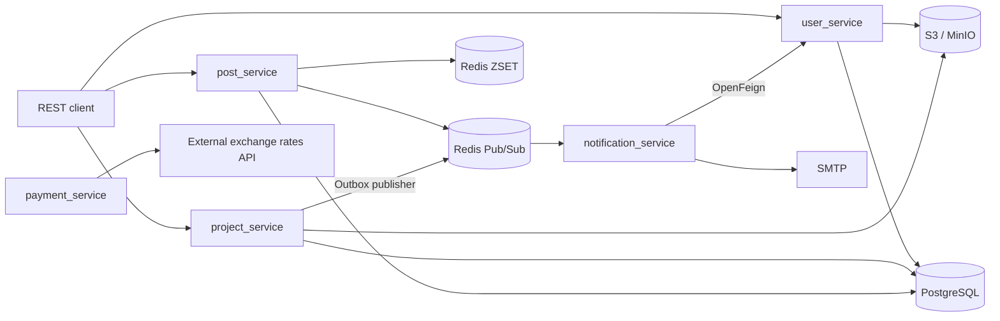

# Dev Social Network

**Социальная платформа для разработчиков и команд** — учебный Java backend-проект, объединяющий идеи LinkedIn и GitHub: профили пользователей, проекты и команды, социальная лента, подписки, комментарии, медиа и уведомления.

> **Статус:** учебный / portfolio project. Функциональность и инженерные решения, перечисленные ниже, автор реализовывал самостоятельно на основе микросервисной структуры проекта. Не все сервисы завершены или запускаются одной командой.

## Стек

**Java 17**, Spring Boot 3, Spring MVC, Spring Data JPA / Hibernate, OpenFeign, WebClient, Spring Scheduler, PostgreSQL, Liquibase, Redis (Pub/Sub, ZSET), S3/MinIO, Docker Compose, Gradle, JUnit 5, Mockito, Testcontainers, JaCoCo, GitHub Actions.

## Функциональность и инженерные решения

| Область | Реализация |
| --- | --- |
| Пользователи | REST API, подписки, фильтрация, импорт CSV, генерация аватаров через внешнее API и сохранение в S3/MinIO |
| Проекты | CRUD, этапы и приглашения, контроль доступа, обложки и S3-хранилище |
| Социальная лента | Посты, хэштеги, отложенная публикация через Scheduler, ExecutorService и батчи |
| Уведомления | События `post.created` через Redis Pub/Sub, OpenFeign, email по SMTP, локализация RU/EN |
| Платежная область | Плановое обновление валютных курсов через WebClient; timeout, Spring Retry, ConcurrentHashMap |
| PostgreSQL / Redis | Устранение N+1 с FETCH JOIN, составные индексы, статистика тегов через Redis ZSET |
| Transactional Outbox | Атомарная запись приглашения и события в PostgreSQL; scheduler публикует ожидающие события в Redis |
| CI и тесты | Unit-тесты, Testcontainers, JaCoCo, CI в сервисных репозиториях |

### Упрощенная архитектура



Диаграмма показывает ключевые потоки, а не полную конфигурацию deployment или все сетевые связи.

### Семантика событий

- Публикация события о создании поста происходит **после commit** транзакции.
- **Redis Pub/Sub — не долговечная очередь:** если получатель отключен, событие может потеряться. Гарантии exactly-once, retries и идемпотентные consumer-ы пока не реализованы.
- Паттерн **Transactional Outbox** гарантирует атомарность бизнес-изменения и записи в outbox, но сам по себе не делает Redis Pub/Sub надежным транспортом до конечного получателя.

Подробности: [документация уведомлений](https://github.com/VladHvedchenya/notification_service/blob/dev/docs/post-created-notifications.md).

## Измерения и тестирование

Для локального сценария обработки **post-created notifications**:

| Метрика | Результат |
| --- | --- |
| Обработано событий без ошибок | **9 000** |
| Пропускная способность | **≈299 событий/с** |
| p95 | **≈48 мс** |
| Конкурентность | **8 одновременно обрабатываемых событий** |
| Функциональные тестовые сценарии | **58, в том числе 8 интеграционных** |
| Покрытие по JaCoCo | **100% исполняемых строк трех ключевых классов** |

**Ограничения:** измерения выполнены с локальными заглушками `user_service` и SMTP; создание постов, PostgreSQL и реальный Gmail не участвовали. Это не пропускная способность всей платформы и не время реальной доставки email.

Для отдельных бизнес-пакетов `project` / `stage` покрытие тестами по JaCoCo достигало **92–95%**; эта цифра не характеризует покрытие всех сервисов.

CI запускается в отдельных репозиториях сервисов, например: [project_service CI](https://github.com/VladHvedchenya/project_service/blob/dev/.github/workflows/ci.yml).

## Репозитории

Корневой репозиторий объединяет **9 сервисов + 1 модуль инфраструктуры через Git submodules**:

- [user_service](https://github.com/VladHvedchenya/user_service) — пользователи и профили
- [project_service](https://github.com/VladHvedchenya/project_service) — проекты и этапы
- [post_service](https://github.com/VladHvedchenya/post_service) — посты и лента
- [notification_service](https://github.com/VladHvedchenya/notification_service) — события и email
- [payment_service](https://github.com/VladHvedchenya/payment_service) — платежная область
- [analytics_service](https://github.com/VladHvedchenya/analytics_service) — аналитика
- [achievement_service](https://github.com/VladHvedchenya/achievement_service) — достижения
- [account_service](https://github.com/VladHvedchenya/account_service) — счета
- [url_shortener_service](https://github.com/VladHvedchenya/url_shortener_service) — короткие ссылки
- [infra](https://github.com/VladHvedchenya/infra) — PostgreSQL, Redis, MinIO

Не все из перечисленных сервисов имеют завершенную предметную логику.

## Локальный запуск

Требуются Git, Docker Compose и JDK 17.

```bash
git clone --recurse-submodules https://github.com/VladHvedchenya/dev-social-network.git
cd dev-social-network
# Если репозиторий был клонирован без субмодулей:
git submodule update --init --recursive

cd infra
docker compose up -d
cd ..
```

В `infra/docker-compose.yaml` на локальных портах доступны PostgreSQL `5432`, Redis `6379`, MinIO API `9000` и MinIO Console `9001`. В текущем Compose используются **демонстрационные учетные данные** — не используйте их при публичном развертывании.

Каждый Spring Boot сервис — отдельный Gradle-проект; его следует настроить и запускать отдельно из IntelliJ IDEA или через Gradle Wrapper. Например, в PowerShell, **из корня проекта**:

```powershell
cd post_service
.\gradlew.bat test
.\gradlew.bat bootRun
```

Для email-функциональности потребуются переменные `MAIL_USERNAME` и `MAIL_PASSWORD` (при использовании Gmail — app password), тестовый получатель и доступный SMTP-сервис. **Не коммитьте реальные пароли и API-ключи.**

Чтобы остановить локальную инфраструктуру, из корня проекта:

```bash
cd infra
docker compose down
```

**Известное ограничение:** нет проверенного one-command запуска всех девяти сервисов; взаимодействующие сценарии могут требовать отдельного запуска соседних сервисов и настройки локальных профилей.

## Следующие шаги

- Retry/DLQ и идемпотентная обработка для более надежных уведомлений.
- Воспроизводимый end-to-end нагрузочный стенд всей экосистемы.
- Дальнейшее расширение интеграционных тестов отказов и межсервисных сценариев.

---

**Автор:** [Vlad Hvedchenya](https://github.com/VladHvedchenya). Учебный backend-проект / портфолио.
