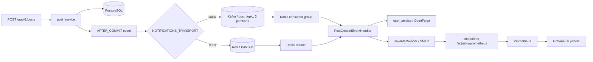
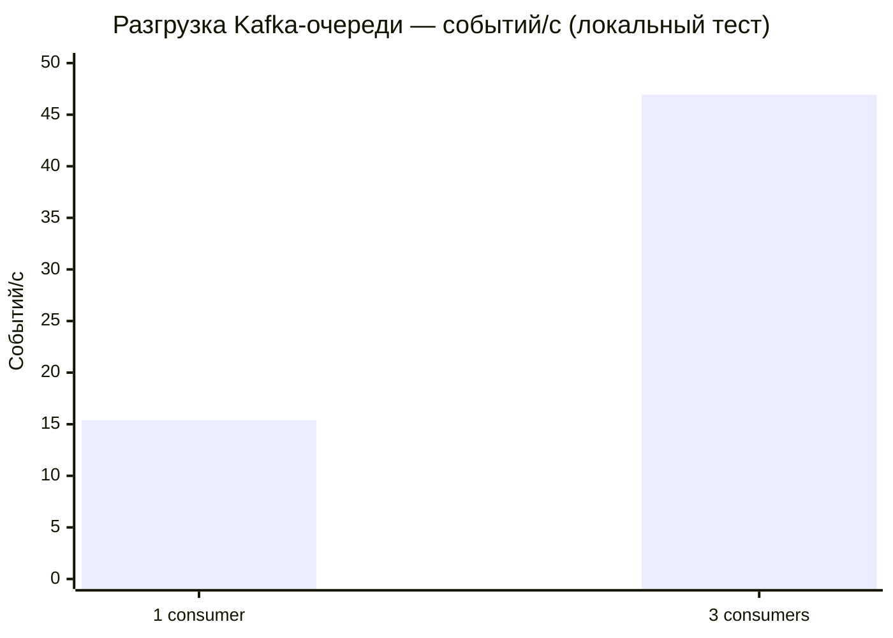

# Dev Social Network

**Java backend-платформа для разработчиков и команд:** профили, проекты и командная работа, посты, подписки, медиа и уведомления. Учебный проект с микросервисной архитектурой; код функциональности и эксперименты я реализовал самостоятельно, используя базовую инфраструктуру буткемпа.

> **Портфолио / pet project.** Ниже приведены результаты **локальных стендов, а не производственной эксплуатации**. Для каждого числа указаны конфигурация, единицы измерения и ограничения. Текущее состояние — не готовая к промышленной эксплуатации распределённая система.

## Инженерные результаты — подтверждение для CV

| Направление | Измеренный результат | Что проверялось |
| --- | --- | --- |
| **Kafka consumer concurrency** | **3,05×** быстрее: **15,38 → 46,93 события/с** | Разгрузка заранее заполненного топика: 1 и 3 consumer-потока, 3 партиции, **7 200** измеренных событий, заглушки внешних зависимостей |
| **Мониторинг + нагрузка Redis-пути** | **57 600** событий; **427 событий/с**, **p95 ≈ 172 мс** в измеренном режиме | Цепочка Redis Pub/Sub → Feign → email-обработчик → SMTP-заглушка; 2 vCPU / 1 GiB, приложение и нагрузочный генератор в одной JVM |
| **Параллельная обработка Kafka** | **3 реально перекрывающихся отправки** | Временные интервалы обработки и peak gauge Micrometer, собранный Prometheus |
| **Ошибки/восстановление** | **20/20** SMTP-отказов учтены; следующие **100** событий обработаны успешно | Корректное разделение метрик успешных/ошибочных попыток; **автоматический retry отсутствует** |
| **Тестирование** | **58 сценариев**, включая **8 интеграционных**; **100% строк** трёх ключевых классов | Изолированные функциональные тесты notification-сценария, не покрытие всей системы |

**Важно:** 427 событий/с и 46,93 события/с — **разные эксперименты с разными конфигурациями**, сравнивать их напрямую нельзя. Показатели не равны HTTP RPS и не доказывают скорость доставки через Gmail. Подробнее — ниже.

**[Полные таблицы p95/p99, throughput, методика, ошибки и три перекрывающихся интервала Kafka](docs/benchmarks/results.md)** — отдельный документ с численными данными, перенесёнными из технического журнала.

### Как проверить реализацию

- **Kafka producer:** [PostCreatedEventPublisher](https://github.com/VladHvedchenya/post_service/blob/dev/src/main/java/faang/school/postservice/publisher/PostCreatedEventPublisher.java), [KafkaPostCreatedEventTransport](https://github.com/VladHvedchenya/post_service/blob/dev/src/main/java/faang/school/postservice/publisher/KafkaPostCreatedEventTransport.java) и [AFTER_COMMIT listener](https://github.com/VladHvedchenya/post_service/blob/dev/src/main/java/faang/school/postservice/listener/PostCreatedNotificationListener.java).
- **Kafka consumer:** [KafkaPostCreatedListener](https://github.com/VladHvedchenya/notification_service/blob/dev/src/main/java/faang/school/notificationservice/listener/KafkaPostCreatedListener.java), [ошибки consumer](https://github.com/VladHvedchenya/notification_service/blob/dev/src/main/java/faang/school/notificationservice/config/kafka/KafkaConsumerConfig.java), [общий обработчик](https://github.com/VladHvedchenya/notification_service/blob/dev/src/main/java/faang/school/notificationservice/service/PostCreatedEventHandler.java).
- **Инструментирование:** [EmailNotificationMetrics](https://github.com/VladHvedchenya/notification_service/blob/dev/src/main/java/faang/school/notificationservice/metrics/EmailNotificationMetrics.java), [Actuator/Micrometer config](https://github.com/VladHvedchenya/notification_service/blob/dev/src/main/resources/application.yaml).
- **Инфраструктура:** [Docker Compose с Kafka/Prometheus/Grafana](https://github.com/VladHvedchenya/infra/blob/master/docker-compose.yaml), [Prometheus scrape config](https://github.com/VladHvedchenya/infra/blob/master/monitoring/prometheus/prometheus.yml), [Grafana dashboard JSON](https://github.com/VladHvedchenya/infra/blob/master/monitoring/grafana/dashboards/notification-service.json).
- **Тесты:** [Kafka producer test](https://github.com/VladHvedchenya/post_service/blob/dev/src/test/java/faang/school/postservice/publisher/KafkaPostCreatedEventTransportTest.java), [Kafka consumer test](https://github.com/VladHvedchenya/notification_service/blob/dev/src/test/java/faang/school/notificationservice/listener/KafkaPostCreatedListenerTest.java), [метрики тест](https://github.com/VladHvedchenya/notification_service/blob/dev/src/test/java/faang/school/notificationservice/metrics/EmailNotificationMetricsTest.java).

Бенчмарки документированы ниже с указанием методики. **Сырые логи и оригинальные скриншоты Grafana этих прогонов пока не выложены в репозиторий**: подробные таблицы результатов и временные интервалы сохранены в [docs/benchmarks/results.md](docs/benchmarks/results.md) и переписаны из журнала. Поэтому читатель может проверить код и конфигурации, но не независимо воспроизвести именно исторические цифры только по этому README. Для полной воспроизводимости необходимо добавить генератор нагрузки, исходные результаты и скриншоты Grafana в `docs/benchmarks/`.

## Архитектура событий уведомлений



Две реализации `PostCreatedEventTransport` выбираются через `@ConditionalOnProperty` **без изменения бизнес-обработчика**. Для Kafka используется ключ `authorId`: события одного автора при неизменном числе партиций направляются в одну партицию и сохраняют порядок внутри неё. В локальном Kafka — **1 брокер KRaft, 3 партиции, replication factor 1**. Это не отказоустойчивый кластер.

`PostCreatedEvent` публикуется слушателем `@TransactionalEventListener(AFTER_COMMIT)`. Создание поста и публикация в Kafka **не атомарны**: между commit и отправкой остаётся окно отказа. В producer используется `KafkaTemplate.send(...).join()`, HTTP-поток ждёт результат записи в брокер, **но не отправки email**. В отличие от этого сценария, Transactional Outbox в `project_service` реализован отдельно для приглашений на этапы проектов.

Для Kafka `enable-auto-commit=false`, `ack-mode=record`. При ошибке `CommonContainerStoppingErrorHandler` останавливает контейнер. **Нет** exactly-once email, DLQ, автоматических retry и идемпотентного consumer; повторная отправка и дубликаты возможны.

### Эксперимент A — Kafka: 1 против 3 consumer

**Задача:** проверить, позволяет ли параллелизм по партициям быстрее обработать накопившиеся сообщения, если чтение автора и SMTP — синхронные операции с ожиданием.

**Стенд:** Windows 11, Java 17.0.19, Intel Core i5-9600KF (6 логических CPU), JVM heap ≤ 512 MiB. Тест выполнялся в отдельной JVM **без полного контекста Spring Boot**; HTTP/SMTP заменены имитацией внешних вызовов, реальная массовая отправка email не выполнялась.

**Методика:**
1. Подготовить 3 партиции по 400 сообщений (равномерное распределение ключей авторов); события публиковались **до начала измерения**.
2. Прогреть по 120 событий в каждом варианте (результаты прогрева исключены).
3. Для `consumer concurrency=1` и `concurrency=3` провести по 3 прогона × 1 200 сообщений. Порядок: **1 → 3 → 3 → 1 → 1 → 3**, чтобы уменьшить влияние прогрева/порядка.
4. Использовать отдельные тестовые топики и consumer groups, не рабочий `post_topic`.
5. Сопоставить длительность разгрузки очереди, throughput и интервалы пересекающихся вызовов. Всего **7 200 измеренных событий** (3 600 на вариант; с прогревом 7 440).

| Показатель | 1 consumer | 3 consumers |
| --- | ---: | ---: |
| Средний throughput, событий/с | **15,38** | **46,93** |
| Ускорение относительно 1 consumer | 1,00× | **3,05×** |
| Максимум одновременно активных отправок | 1 | **3** |



**Доказательство параллельности:** отдельно записаны start/end-моменты вызовов; в одном прогоне **три интервала перекрывались во времени**. Параллельно Prometheus снимал `notifications.email.active` и `notifications.email.peak` с шагом 1 с, пиковое значение составило **3**. Разные имена потоков сами по себе таким доказательством не являются.

**Интерпретация:** ускорилась **обработка очереди целиком**, не отдельная SMTP-операция. Один consumer при блокирующем Feign/SMTP ждёт завершения I/O; три consumer могут ждать параллельно. Поскольку сообщения были накоплены заранее, **это не тест максимальной устойчивой входной нагрузки и не RPS приложения**. Результат зависит от партиционирования; все сообщения одного автора могут оказаться в одной партиции.

### Эксперимент B — Prometheus / Grafana / Redis-путь

**Задача:** добавить наблюдаемость email-уведомлений и найти компромисс между throughput и задержками под нагрузкой, включая искусственные SMTP-отказы.

**Инструменты:** Spring Boot Actuator + Micrometer `Timer` (с тэгами `outcome=success/error`), histogram buckets для `notifications.email.send`, Gauges `notifications.email.active/peak`, Prometheus (обычный scrape каждые **15 с**, хранение 7 суток) и Grafana с шестью панелями (health, JVM threads, heap, throughput, средняя длительность, p95/p99). Docker Compose и Grafana provisioning хранятся в `infra`.

**Нагрузочный стенд:** Linux/Docker, лимиты Java-контейнера **2 vCPU / 1 GiB**. Путь `Publisher → Redis Pub/Sub → Notification Service → Feign → JavaMailSender → SMTP`; `user_service` и SMTP заменены локальными заглушками. Генератор событий, приложение и заглушки были в одной JVM, что влияет на полученные результаты.

**Методика:** прогрев 15 с, затем **четыре уровня параллельности**, каждый по **3 прогона × 20 с**; всего **57 600** событий основного измерения.

| Проверка | Зафиксировано |
| --- | --- |
| Измеренный режим с высокой пропускной способностью | **427 событий/с**, **p95 ≈ 172 мс**; три прогона **405–453 события/с** |
| Замедление локального SMTP на 200 мс (16 параллельных событий) | **66,8 события/с**, **p95 = 252,9 мс** |
| 20 искусственных ошибок SMTP | **20 ошибочных попыток** в метриках, 0 ложных успехов |
| Восстановление заглушки SMTP | **100 новых** событий успешно обработаны; старые ошибочные **не** повторяются автоматически |
| Тестовые Prometheus scrapes (отдельно, раз в 2 с) | **134/134** успешных, максимум **61,6 мс** |

При росте параллелизма с 16 до 32 throughput дополнительно вырос на **24%**, но p95 увеличился примерно в **2,8 раза**: для этого стенда **16 было более сбалансированной конфигурацией**.

**Что означают метрики:** `throughput` — число обработанных событий за секунду, **не HTTP RPS**. `p95=172 мс` — не менее 95% наблюдений укладываются в эту границу (примерно 5% медленнее). `p99` позволяет отслеживать более редкие задержки. Высокая пропускная способность не означает хорошую latency — важны обе величины. Время считалось от публикации события до принятия сообщения **локальной SMTP-заглушкой**, не до доставки в реальный почтовый ящик.

**Ограничения:** создание поста в PostgreSQL, реальный Gmail/TLS и многоброкерная Kafka не измерялись; `Redis Pub/Sub` не сохраняет сообщения offline-consumer и не гарантирует доставку. Диагностический Windows-прогон с 32 `BindException` / TIME_WAIT **исключён из успешных Linux-результатов** и не смешивается с ними.

### Ранее проведённый изолированный тест

Для notification-сценария также есть отдельный тест **9 000 событий, ≈299 событий/с, p95 ≈48 мс, 8 конкурентных событий** с локальными заглушками. **Он не сопоставим напрямую** ни с Kafka-тестом, ни с Docker-нагрузкой Redis-пути.

## Технологии и функциональность

- **Java 17, Spring Boot 3, JPA/Hibernate, PostgreSQL, SQL, Liquibase, Redis, Spring Kafka, Micrometer, Spring Boot Actuator, Prometheus, Grafana, Docker Compose, Gradle, JUnit 5, Mockito, Testcontainers, JaCoCo, GitHub Actions.**
- **Профили и пользователи:** REST API, фильтрация, подписки, CSV import, аватары из внешнего API и S3/MinIO.
- **Проекты:** создание, этапы, приглашения, контроль доступа, Transactional Outbox для приглашений; S3-обложки.
- **Лента:** посты, приватность медиа, хэштеги, отложенная публикация через Scheduler / ExecutorService.
- **Уведомления:** `post.created` через Redis или Kafka, OpenFeign для получения автора, локализованные email RU/EN, метрики success/error/latency.
- **Оптимизация:** JOIN FETCH против N+1, составные индексы PostgreSQL, Redis ZSET для статистики хэштегов.
- **Интеграции:** обновление курсов валют через WebClient, timeout и Spring Retry.
- **Качество:** 58 сценариев notification, 8 интеграционных, 100% строк трёх ключевых классов; 92–95% некоторых пакетов project/stage, **не всей кодовой базы**.

## Структура репозиториев

Корневой Git-репозиторий — **9 сервисов + infra в Git submodules**:

| Модуль | Назначение |
| --- | --- |
| [user_service](https://github.com/VladHvedchenya/user_service) | Профили, пользователи |
| [project_service](https://github.com/VladHvedchenya/project_service) | Проекты, приглашения |
| [post_service](https://github.com/VladHvedchenya/post_service/tree/dev) | Публикации, Kafka/Redis producer |
| [notification_service](https://github.com/VladHvedchenya/notification_service/tree/dev) | Kafka/Redis consumer, SMTP, Micrometer |
| [payment_service](https://github.com/VladHvedchenya/payment_service) | Валютные курсы |
| [analytics_service](https://github.com/VladHvedchenya/analytics_service) | Аналитика |
| [achievement_service](https://github.com/VladHvedchenya/achievement_service) | Достижения |
| [account_service](https://github.com/VladHvedchenya/account_service) | Счета |
| [url_shortener_service](https://github.com/VladHvedchenya/url_shortener_service) | Сокращение ссылок |
| [infra](https://github.com/VladHvedchenya/infra/tree/master) | Kafka, PostgreSQL, Redis, MinIO, Prometheus, Grafana |

**Состояние Git submodules:** корневой репозиторий фиксирует конкретные коммиты сервисов; прямые ссылки выше на `dev` / `master` указывают на проверенные ветки с текущими Kafka/monitoring-фичами. Если `git clone --recurse-submodules` загрузит старые gitlink-коммиты, для работы с последними изменениями потребуется обновить указатели submodules отдельным коммитом в корне.

## Локальный запуск

**Необходимы:** Git, JDK 17, Docker Compose, конфигурация окружения каждого сервиса.

```bash
git clone --recurse-submodules https://github.com/VladHvedchenya/dev-social-network.git
cd dev-social-network
git submodule status

# запускает инфраструктуру из infra/docker-compose.yaml:
cd infra
docker compose up -d
docker compose ps
```

Инфраструктура включает PostgreSQL (5432), Redis (6379), MinIO (9000/9001), Kafka (9092), Prometheus (9090), Grafana (3000). Часть портов закреплена за `localhost`. **Не публикуйте демонстрационные пароли наружу**.

Для email-уведомлений задайте `MAIL_USERNAME` / `MAIL_PASSWORD` в локальных run configurations; Gmail использует app password. Выберите одинаковый транспорт в `post_service` и `notification_service`:

```bash
# для обоих сервисов, пример значений окружения:
NOTIFICATIONS_TRANSPORT=kafka
NOTIFICATIONS_KAFKA_CONCURRENCY=3   # используется notification_service
```

`NOTIFICATIONS_TRANSPORT=redis` выбирает прежний путь (также default). В Kafka создайте `post_topic` с **3 партициями** и фактором репликации 1. Пример для запущенного контейнера:

```bash
docker compose exec kafka /opt/kafka/bin/kafka-topics.sh --bootstrap-server localhost:9092 --create --if-not-exists --topic post_topic --partitions 3 --replication-factor 1
```

`notification_service` предоставляет метрики на **`http://localhost:8083/actuator/prometheus`**. Prometheus по конфигурации ищет `host.docker.internal:8083`, Grafana provision-ит datasource и dashboard. При Linux без `host.docker.internal` потребуется дополнительная настройка сети контейнера. Сбор метрик не означает, что сервис гарантирует доставку email.

Сервисы стартуют **по отдельности** из их Gradle-проектов и могут требовать запущенных соседних сервисов. One-command запуска всех девяти приложений пока нет. Для остановки только инфраструктуры:

```bash
cd infra
docker compose down
```

## Что ещё нужно сделать

- Закоммитить **воспроизводимый нагрузочный harness, сырые результаты и изображения** панелей Grafana/трасс в `docs/benchmarks/`. Настоящий README содержит методику и сохранённые агрегаты, но это **не замена первичным артефактам**.
- Для критичных уведомлений проработать Outbox публикации `post.created`, retry/DLQ и идемпотентность SMTP-consumer.
- Проверить failover нескольких Kafka brokers и полноценную end-to-end нагрузку реальных REST-потоков без заглушек.

---

**Автор:** [Vlad Hvedchenya](https://github.com/VladHvedchenya) · учебный Java backend-проект / портфолио.
